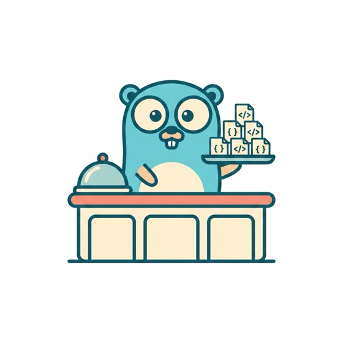

# protobuffet

<p align="center">
  
</p>

A schema registry for Protocol Buffers that you run yourself. It publishes
generated SDKs as packages your language already understands:

```sh
go get registry.example.com/gen/go/acme/catalog        # Go module proxy
pip install acme-catalog-proto                         # PyPI index
composer require acme/catalog-proto                    # Composer repository
npm install @acme/catalog                              # npm registry
```

One binary, one directory on disk. No database, no object storage, no broker.

## Why

Sharing `.proto` files between repositories usually means copying them, or a
git submodule. Copies drift. Submodules have no versions and no way to tell you
that a change will break the service on the other side.

A registry fixes both, but the hosted one (Buf Schema Registry) costs money for
private schemas, needs an enterprise plan to self-host, and is unreachable from
some networks. protobuffet is the part most teams need, Apache-2.0, on your own
hardware.

## Install and run

```sh
go install github.com/smoreg/protobuffet/cmd/buffet@latest    # CLI
buffet token                                                  # mint a credential

docker run -d -p 8080:8080 -v protobuffet:/data \
  -e BUFFET_ADMIN_TOKEN=<token> ghcr.io/smoreg/protobuffet:latest
```

Or without Docker: `go install github.com/smoreg/protobuffet/cmd/buffetd@latest`
and `BUFFET_ADMIN_TOKEN=<token> buffetd`.

Open `http://localhost:8080` for the module list and the install commands for
each published version.

## Publish a schema

Put a `buffet.yaml` next to your `.proto` files:

```yaml
version: v1
module: acme/catalog
proto: proto

targets:
  go:
    module: registry.example.com/gen/go/acme/catalog
    template: buf.gen.go.yaml
    out: gen/go
    require:
      - google.golang.org/protobuf v1.36.12

  python:
    package: acme-catalog-proto
    template: buf.gen.py.yaml
    out: gen/python
    requires:
      - "protobuf>=5.27"

  composer:
    package: acme/catalog-proto
    template: buf.gen.php.yaml
    out: gen/php
    require:
      php: ">=8.1"
      google/protobuf: "^4.29"
```

Then:

```sh
export BUFFET_REGISTRY=http://localhost:8080 BUFFET_TOKEN=<token>
buffet publish -version v1.0.0 -label main
```

`buffet publish` runs `buf lint`, generates the code, packs one artifact per
target and uploads them. The server compares the schema against the previous
version and refuses the push if it would break consumers.

A working example is in [`examples/catalog`](examples/catalog).

## Consume it

**Go** — the registry answers `go get` discovery, so nothing but `GOPRIVATE`
is needed:

```sh
export GOPRIVATE=schemas.example.com/*
go get schemas.example.com/gen/go/acme/catalog@v1.0.0
```

This requires the registry to be reachable on the default port under the same
hostname that starts the module path: a Go module path cannot contain a port.
For a registry on another port, point `GOPROXY` at it instead:

```sh
export GOPROXY=http://localhost:8080/go,https://proxy.golang.org,direct
export GONOSUMDB='localhost/*'
go get registry.example.com/gen/go/acme/catalog@v1.0.0
```

Never `GOSUMDB=off`: it disables checksum verification for every dependency in
the build, not just for schemas.

**Python**:

```sh
pip install --index-url http://localhost:8080/pypi/simple \
            --extra-index-url https://pypi.org/simple acme-catalog-proto==1.0.0
```

**PHP**:

```sh
composer config repositories.protobuffet composer http://localhost:8080/composer
composer require acme/catalog-proto:1.0.0
```

**JavaScript**:

```sh
npm install @acme/catalog@1.0.0 --registry http://localhost:8080/npm
```

## How it works

```
   schema repo                registry                    consumers
 ┌──────────────┐  publish  ┌────────────────┐  go get  ┌──────────────┐
 │ buf.yaml     │──────────►│ versions       │─────────►│ Go services  │
 │ buffet.yaml  │           │ schema archive │  pip     ├──────────────┤
 │ proto/*.proto│           │ generated SDKs │─────────►│ Python apps  │
 └──────────────┘           │ breaking check │  require ├──────────────┤
        │                   └────────────────┘─────────►│ PHP, Node    │
        │ buf lint + buf generate     ▲                 └──────────────┘
        └─────────────────────────────┘
```

Code generation runs on the client, in the repository that owns the schema,
where buf is already installed. The server stores artifacts and serves them; it
never runs generation plugins. That keeps the server small and its attack
surface narrow.

## Compared to the Buf Schema Registry

| | BSR | protobuffet |
|---|---|---|
| Self-hosting | enterprise plan | yes, Apache-2.0 |
| Private schemas | paid, per type | free |
| Go module proxy | yes | yes |
| PyPI index | yes | yes |
| npm registry | yes | yes |
| Composer repository | no | yes |
| Maven, Cargo, NuGet, Swift | yes | no |
| Breaking-change gate on push | yes | yes |
| Versions, labels, immutability | yes | yes |
| Hosted code generation (remote plugins) | yes | no, generation is local |
| Schema dependencies (`deps:` resolution) | yes | no, use buf.build or git |
| Generated documentation, search | yes | no |
| Organizations, RBAC, SSO, SCIM | yes | no, tokens with read/write scopes |
| Package-name ownership across modules | yes | yes |
| Refuse to start when the gate cannot run | — | yes (`breaking_check: required`) |
| Reflection API, webhooks, Studio | yes | no |

If you need organization management, SSO or hosted plugins, buy the BSR.
protobuffet covers publishing, versioning, distribution and the compatibility
gate.

## Limitations

- One node. Storage is a directory; back it up and run a single instance.
- Tokens are registry-wide (`read`, `write`, `admin`). No per-module access.
- The registry does not host schema dependencies. `deps:` in `buf.yaml` still
  resolves through buf.build or vendored copies.
- No generated documentation browser.

## Commands

```
buffet publish   generate SDKs, pack and push a version
buffet check     compare local schemas against the registry without publishing
buffet list      list modules
buffet info      show versions, targets and labels of one module
buffet login     store a token for a registry
buffet token     mint a token and print its config digest
```

Kubernetes: [`docs/kubernetes.md`](docs/kubernetes.md) and [`deploy/k8s`](deploy/k8s).
Server configuration: [`buffetd.example.yaml`](buffetd.example.yaml).
Running it in production: [`docs/self-hosting.md`](docs/self-hosting.md).
Endpoints and formats: [`docs/protocol.md`](docs/protocol.md).

## Development

```sh
make build   # binaries into ./bin
make test    # unit and integration tests
make lint    # go vet and a gofmt check
make e2e     # publish, then install with the real go, pip and composer clients
```

`make e2e` starts a registry, publishes the example module, installs the
resulting packages with the actual clients, then checks that a field rename is
rejected and an added field is accepted.

It needs `buf`, `protoc-gen-go` and `protoc` on PATH. PHP and Python parts are
skipped if those toolchains are missing.

## Things that cost people an afternoon

- `targets.go.module` must equal the `go_package_prefix` in the generation
  template. Otherwise consumers import a path the registry does not serve.
- A Go module path cannot contain a port, so `go get` without `GOPROXY` works
  only when the registry serves on 443 under the hostname that starts the
  module path.
- From `v2.0.0` on, Go puts the major version in the import path. Publishing
  `v2` means `targets.go.module` ends in `/v2`, and the generation template's
  `go_package_prefix` matches. The registry refuses the push otherwise.
- PHP and Python generation use `protoc_builtin`, which needs the `protoc`
  binary. The Go plugin is standalone and does not.
- With `public_read: false`, put the registry *after* the public proxy in
  `GOPROXY`: the go command only falls through on 404 and 410, not on 401.

## License

Apache-2.0. See [LICENSE](LICENSE).
